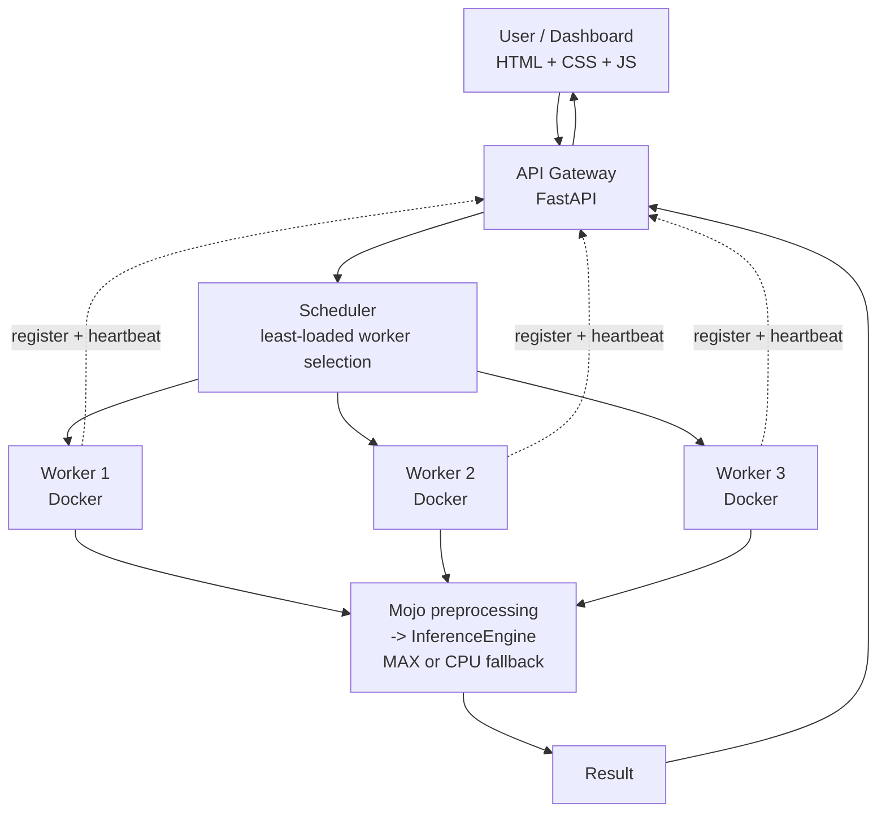

# Distributed AI Inference Platform

A small, understandable **distributed AI inference platform** that runs on one
laptop: a FastAPI gateway receives a prompt, a scheduler picks the least-loaded
healthy worker, that worker preprocesses the prompt with **Mojo** and runs a real
model through **MAX** (with a real CPU fallback), and the result comes back to the
user. Deployable with **Docker Compose** and with **Kubernetes/Minikube** using
multiple worker replicas.

> **Status: under construction (Phase 2 of 19 complete).**
> This README is a placeholder; the full documentation is written in Phase 18.
> Current progress is tracked in [`AGENTS.md`](AGENTS.md) section 6.

## Try the API gateway now (Phase 2)

```bash
python -m venv .venv
.venv\Scripts\activate                  # Windows  (source .venv/bin/activate elsewhere)
pip install -r requirements.txt
python -m uvicorn api.main:app --reload --port 8000
```

Then, in a second terminal:

```bash
python scripts/smoke_api.py             # exercises every endpoint over real HTTP
```

Interactive docs: <http://127.0.0.1:8000/docs>

| Endpoint | Purpose |
|---|---|
| `GET /` | index of the API |
| `GET /health` | API liveness + worker counts |
| `GET /workers` | live worker list (registration + heartbeat driven) |
| `GET /stats` | request/latency/worker counters |
| `GET /activity` | recent jobs (dashboard log) |
| `POST /infer` | run inference (dispatch wired in Phase 5) |
| `POST /workers/register`, `POST /workers/heartbeat`, `DELETE /workers/{id}` | called by workers themselves |


## Architecture



## Technologies

| Layer | Technology |
|---|---|
| API gateway, scheduler, worker, monitoring | Python 3.12 + FastAPI |
| AI inference (primary) | MAX (Modular) |
| AI inference (development fallback) | CPU model via `transformers` |
| Performance-critical preprocessing | Mojo |
| Containers | Docker + Docker Compose |
| Orchestration | Kubernetes (Minikube / k3s) |
| Dashboard | plain HTML / CSS / JavaScript |

## Folder structure

```
distributed-ai-inference/
├── api/          FastAPI gateway, scheduler, worker registry   (Phase 2, 5)
├── worker/       worker service, inference engines, heartbeat  (Phase 3, 4, 6, 7)
├── mojo/         preprocess.mojo                               (Phase 8)
├── dashboard/    index.html, style.css, app.js                 (Phase 14)
├── k8s/          Kubernetes manifests                          (Phase 12)
├── tests/        pytest suite                                  (Phase 17)
├── scripts/      demo helper scripts
├── docs/         screenshots
├── requirements.txt
├── .env.example
├── AGENTS.md
└── README.md
```

## Prerequisites (checked against this machine)

| Requirement | Needed for | Present here |
|---|---|---|
| Python 3.11+ | local run + tests | yes (3.12.2) |
| git | version control | yes (2.50.1) |
| Docker Desktop | Phases 9–11 | **no — must be installed** |
| Minikube + kubectl | Phases 12–13 | **no — must be installed** |
| MAX / Mojo (Linux or WSL2) | Phases 7–8 | **no — used inside the Linux worker image** |

MAX and Mojo do not run on native Windows; on Windows they run inside the Linux
worker container or under WSL2. Latest upstream release at project start:
**MAX 26.5 / Mojo 1.0.0**.

## Next steps

Phase 3: implement the worker service (`GET /health`, `GET /info`, `POST /infer`)
so that a real worker can register with this gateway.
